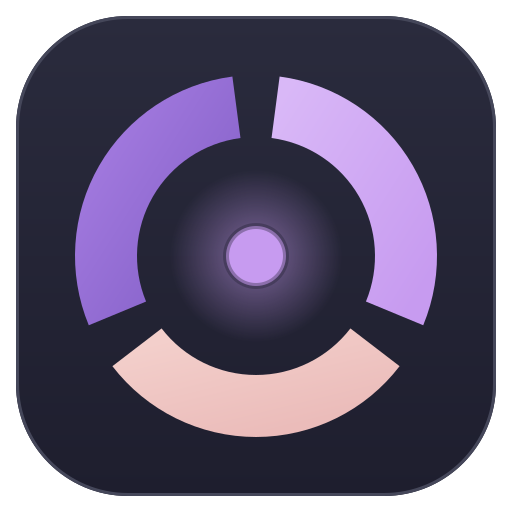

# LOQ Center

A GTK3 control panel for **Lenovo LOQ**, **Legion** and **IdeaPad Gaming** laptops on Linux, inspired by Lenovo Legion Toolkit. Built for **EndeavourOS / Arch with Hyprland and HyDE**, with an optional **4-zone RGB keyboard** tab.

Everything in the window is detected at runtime. A control appears only when your kernel or a tool on your machine really provides it.

<p align="center"></p>

---

## Files

| File | What it does |
| :--- | :--- |
| `loq_controller_install.sh` | Installs LOQ Center (Dashboard, Power, Display, Graphics tabs), the root helper, the Polkit policy, the app icon, the desktop entry and the HyDE/Hyprland integration. Contains no RGB code. |
| `loq_rgb.sh` | Optional. Adds the **LOQ RGB** tab as a plugin, plus the udev rules and PyUSB for the keyboard. Run it after the main installer. |
| `src/loq-center` | The LOQ Center app (Python and GTK). |
| `src/loq-center-helper` | The small root helper that changes the hardware settings, run through Polkit. |
| `src/dev.loqcenter.policy` | The Polkit policy for the helper. |
| `src/loq-center.dcol` | The HyDE wallbash colour template. |
| `icon/loq-center.svg` | The app icon. |

The installer downloads everything in `src/` and `icon/` from this repository, or uses the copies next to it when you cloned the repository. Keep the folders in place and keep every file under 100 KB.

LOQ Center loads every plugin in `~/.config/loq-center/plugins/*.py`. Without `loq_rgb.sh` you get the four core tabs. Edit `loq_rgb.sh` and run it again, and the RGB tab updates without touching the main installer.

---

## Features

### Dashboard
- CPU temperature, CPU load, memory, battery %, battery power draw and fan speed.
- **Animated fans**: one small fan per fan. The faster the fan runs, the faster its blades turn, and the blades slow down and stop when the fan stops. The motion shows the speed level, not the real RPM, which is too fast to draw. It only moves while the Dashboard tab is open.
- One-click presets: **Battery saver**, **Daily**, **Performance**. Each sets the performance mode, the screen refresh rate and the brightness together.

### Power
- **Performance mode**: Quiet, Balanced, Performance, Max power and Cooling. Uses the kernel platform profile (modern `/sys/class/platform-profile/` and the older ACPI file), with `powerprofilesctl` as a fallback. `Fn+Q` stays in sync.
- **Max power**: the firmware's own Extreme mode when it exists, otherwise Custom mode with the firmware power limits at maximum. The charger must be plugged in.
- **Cooling**: Custom mode with the lowest firmware power limits, capped CPU and integrated-GPU clocks, the NVIDIA clock locked low while the GPU is awake, and the fans at full speed. Full fan speed goes through `legion_laptop`, `acpi_call` or the `lenovo_wmi_other` driver, whichever works. Your previous limits are restored when you pick another mode.
- **Battery charging**: Battery care (firmware charge limit), Full charge, Rapid charge.
- **Sleep and idle timer**: `hypridle` presets of 5 min, 10 min, 30 min or Never (dim, lock, screen off, sleep).
- **Battery health**: remaining capacity compared with new, and charge cycles.

### Auto (charger plugged in or on battery)
Choose one set of settings for **On charger** and another for **On battery**. LOQ Center applies them by itself when you plug in or unplug the charger.

- Per power source you can set the performance mode, the refresh rate, the sleep timer and the screen brightness. **Keep** leaves a setting alone.
- Max power is not offered for battery, because it needs the charger.
- A small background service does the switching, so it works with the window closed. It starts when you log in or when you turn Auto on, and it does nothing while Auto is off.
- It acts only when the power source changes. Your own changes in between are never overridden.
- The **Apply** button in the tab tries the current power source straight away.
- Settings are saved in `~/.config/loq-center/auto.json`.

### Display
- Refresh rate of the built-in screen through `hyprctl`. It resets when Hyprland reloads.
- Screen brightness slider and keyboard backlight level (`brightnessctl`).
- Hardware switches: **Fn lock** and **Camera**.

### Graphics
- NVIDIA power state, read from sysfs so a sleeping GPU stays asleep. GPU sensors are read only when you press the button.
- GPU mode, applied after a reboot:
  - **Integrated** and **Hybrid** through `envycontrol`.
  - **dGPU only** through the firmware MUX switch. This is new and not yet tested on real hardware, and the app warns you before it runs.

### LOQ RGB (needs `loq_rgb.sh`)
- Controls 4-zone ITE keyboards (vendor `048d`, product IDs `c995`, `c994`, `c993`, `c985`, `c984`, `c983`, `c975`, `c973`, `c965`, `c963`, `c955`) through `/dev/hidraw*`, with a PyUSB fallback.
- Effects: Static, Breath, Wave, Spectrum, Off. Brightness Low or High, speed 1 to 4.
- Four zone colours with a colour picker, **Set All Zones**, and **HyDE Sync**, which takes four accent colours from your current wallpaper theme.
- Four profile slots, saved in `~/.config/loq-center/rgb.json`.

---

## Install

Run as your normal user, not with `sudo`. The scripts ask for `sudo` only where needed: the root helper, the Polkit policy, kernel module packages and udev rules.

### 1. One command

Paste this in a terminal. It downloads and runs the installer, with no clone and no folder:

```bash
bash <(curl -fsSL https://raw.githubusercontent.com/aditandava/LOQ-controler-linux/main/loq_controller_install.sh)
```

### 2. Optional: RGB keyboard

```bash
bash <(curl -fsSL https://raw.githubusercontent.com/aditandava/LOQ-controler-linux/main/loq_rgb.sh)
```

Both in one go:

```bash
bash <(curl -fsSL https://raw.githubusercontent.com/aditandava/LOQ-controler-linux/main/loq_controller_install.sh) && bash <(curl -fsSL https://raw.githubusercontent.com/aditandava/LOQ-controler-linux/main/loq_rgb.sh)
```

Prefer to read the scripts first? Clone the repo and run them yourself:

```bash
git clone https://github.com/aditandava/LOQ-controler-linux.git
cd LOQ-controler-linux
bash loq_controller_install.sh
```

Uninstall the same way, adding `--uninstall` inside the command: `bash <(curl -fsSL <script link>) --uninstall`.

Close and reopen LOQ Center to see the **LOQ RGB** tab.

The installer needs internet access to fetch the icon. If the download fails, the app still works with a stock icon, and running the installer again fixes it.

---

## HyDE and Hyprland integration

This is built in. You do not set anything up.

- **HyDE theme sync**: the window follows your HyDE wallpaper colours (wallbash) and updates when the theme changes.
- **HyDE Sync button** (RGB tab): copies four accent colours from your current HyDE theme to the keyboard zones.
- **Hyprland shortcut**: `SUPER + SHIFT + L` opens LOQ Center, added only if the key is free.
- **Floating window**: on HyDE setups that use `hyprland.lua`, a window rule opens it centred and floating (a backup of your config is kept).
- **Login start**: the Auto watcher is started by Hyprland at login.
- **Display tab**: refresh rate switching uses `hyprctl`.
- **Sleep and idle timer**: edits your `hypridle` config.

If you do not use Hyprland or HyDE, LOQ Center still installs. These parts are skipped or hidden, and you open it from the app launcher.

---

## Ubuntu, Debian, Fedora and openSUSE

The installer detects your package manager, so the same one command works. Make sure `curl` is installed first (Fedora: `dnf`, openSUSE: `zypper`):

```bash
sudo apt install -y curl
bash <(curl -fsSL https://raw.githubusercontent.com/aditandava/LOQ-controler-linux/main/loq_controller_install.sh)
```

It is written for Arch / EndeavourOS, so on other distros note these differences:

| What | On Ubuntu and other non-Arch distros |
| :--- | :--- |
| Core app (Dashboard, Power, charging, brightness, battery health) | Installs and works. |
| Refresh rate, sleep and idle timer, shortcut | Need Hyprland and `hypridle`. On GNOME or KDE these controls are hidden. |
| Full fan speed and dGPU only | `acpi_call` is not installed for you. Install it yourself, for example `sudo apt install acpi-call-dkms`. |
| Integrated GPU mode | `envycontrol` is not installed for you. Install it from its project page, then run the installer again. |
| RGB keyboard | `loq_rgb.sh` installs PyUSB with your package manager and works the same. |

The Ubuntu path has not been tested on real hardware.

### Dependencies

Installed automatically on Arch / EndeavourOS (`pacman`), Debian / Ubuntu (`apt`), Fedora (`dnf`) and openSUSE (`zypper`):

- `python3`, PyGObject and GTK3, `polkit` (`pkexec`), `brightnessctl`
- Arch only: `acpi_call-dkms` with kernel headers, needed for full fan speed and dGPU only
- Optional: `envycontrol` from the AUR (via `yay` or `paru`) for the Integrated GPU mode
- `python-pyusb` for the RGB tab

---

## Use

- **Shortcut**: `SUPER + SHIFT + L`, added automatically when the key is free.
- **App launcher**: search for **LOQ Center**.
- **Terminal**:

```bash
~/.local/bin/loq-center             # open the window
~/.local/bin/loq-center --status    # print detected hardware as JSON
~/.local/bin/loq-center --version
~/.local/bin/loq-center --daemon    # the Auto watcher (started for you)
```

Check that the Auto watcher is running after a login:

```bash
pgrep -af 'loq-center --daemon'
```

- **Apply the last RGB profile from a script**:

```bash
python3 ~/.config/loq-center/plugins/rgb.py --apply
```

---

## Other keyboards

If your keyboard's product ID is not in the list, edit the rules in `loq_rgb.sh` (or uncomment the generic `048d` lines) and run `bash loq_rgb.sh` again.

---

## Uninstall

RGB plugin and udev rules only:

```bash
bash loq_rgb.sh --uninstall
```

LOQ Center itself:

```bash
bash loq_controller_install.sh --uninstall
```

Your battery and performance settings stay as you last set them.
